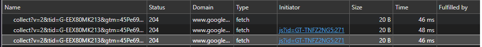
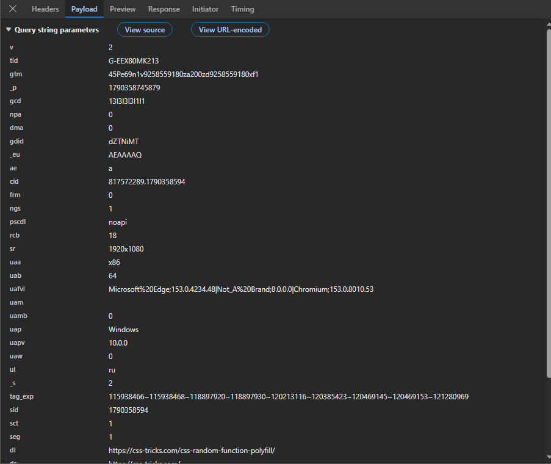

# Домашняя работа № 1 · Путь данных от ссылки до заявки

**Дисциплина:** ОП.03 «Информационные технологии»

| Поле | Значение |
|---|---|
| Фамилия, имя, отчество | Зотов Владислав Сергеевич |
| Группа | РПО 9/25/3 |
| Номер работы | 1 |
| Тема работы | Цифровая воронка: путь данных от ссылки до заявки |
| Дата сдачи | 25.09.2026 |
| Ветка | `main` |

---

## Задание

1. Открыть сайт, панель разработчика (F12) → **Network**, в фильтре `collect`,
   галочка **Preserve log**.
2. Сделать три действия: обновить страницу, прокрутить до низа, нажать
   на товар. Записать, какие события ушли — параметр `en` на вкладке **Payload**.
3. Описать путь пользователя от ссылки до заявки, пять шагов.
4. Найти одно место на этом пути, где данные могут потеряться.
5. Приложить скриншоты `screens/01-network.png` и `screens/02-payload.png`.

Сайт: https://shop.merch.google/, запасные — https://habr.com/ru/,
https://www.smashingmagazine.com/, https://css-tricks.com/. Открывать
в Chrome или Edge с выключенным блокировщиком рекламы.

Срок — до начала занятия 2. Работа сдаётся коммитом в `main`.

---

## 1. Какой сайт смотрел

| Поле | Значение |
|---|---|
| Название сайта | css-tricks |
| Адрес | https://css-tricks.com/ |
| Откуда сайт | из списка в задании |

## 2. Три действия и что отправил счётчик

Панель Network, фильтр `collect`, галочка Preserve log. Название события
лежит в параметре `en` на вкладке Payload.

| № | Что я сделал на сайте | Название события (`en`) | Что ещё было в Payload |
|---|---|---|---|
| 1 | обновил страницу | `page_view` | `dr` — адрес предыдущей страницы (referrer); фактическое значение в приложенном фрагменте кадра не видно |
| 2 | прокрутил до низа | `scroll` | `tid` — идентификатор потока GA4, на кадре `G-EEX80MK213` |
| 3 | перешёл по ссылке на статью | `page_view` | `uap=Windows` — платформа устройства; `dl` — адрес открытой статьи |

Скриншоты:

## 3. Путь пользователя: 5 шагов

Пример пути до заявки на курс, отдельно от наблюдений за событиями на CSS-Tricks.

| №  |  Мой шаг |
| --- | --- |
| 1  |  Человек видит ссылку на курс и переходит по ней. |
| 2  |  Изучает программу и условия на странице курса. |
| 3  |  Переходит к форме заявки. |
| 4  |  Вводит имя и контактные данные. |
| 5  |  Нажимает «Отправить», заявка сохраняется для менеджера. |

## 4. Где данные могут потеряться

| № | На каком шаге | Что может потеряться |
|---|---|---|
| 1 | 1 — переход по ссылке | Если редирект удалит UTM-метки, заявка может сохраниться без сведений о рекламной кампании. |
| 2 | 4 — заполнение формы | Если человек закроет страницу до отправки, введённые данные могут потеряться, если форма не сохраняет черновик. Заявка не поступит менеджеру. |

## 5. Использование ИИ

| Вопрос | Ответ |
|---|---|
| Что сделал сам | Самостоятельно зашел на сайт с выключенным блокировщиком, открыл панель Network, нашел отправленные события по фильтру collect, изучил вкладку Payload и сделал необходимые скриншоты. |
| Что спросил у модели | Помощь с правками, проверкой работы и оформлением отчёта. |
| Что после этого изменил | Уточнил формулировки, исправил неточности и сверил текст с имеющимися материалами. |
