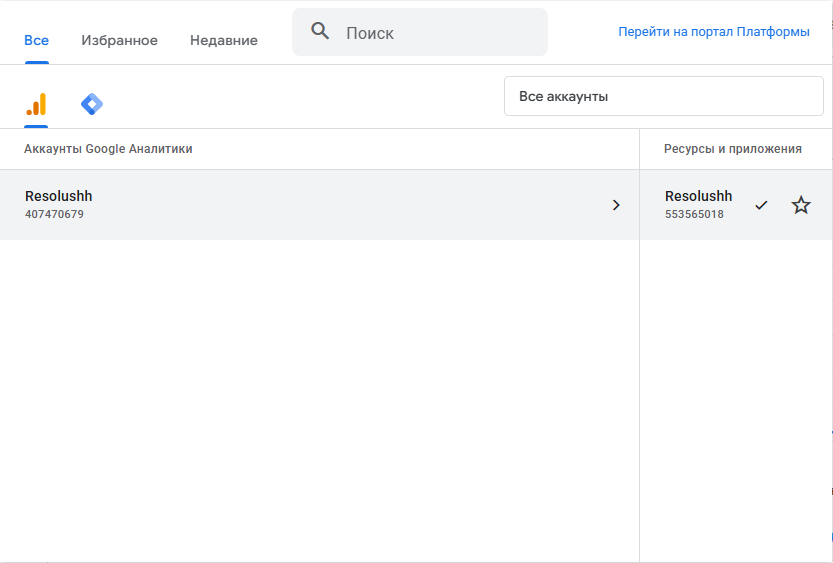
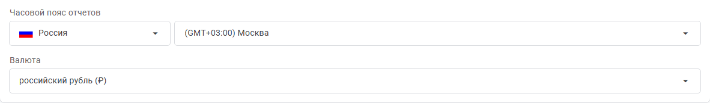
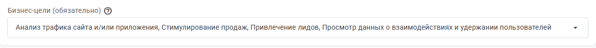
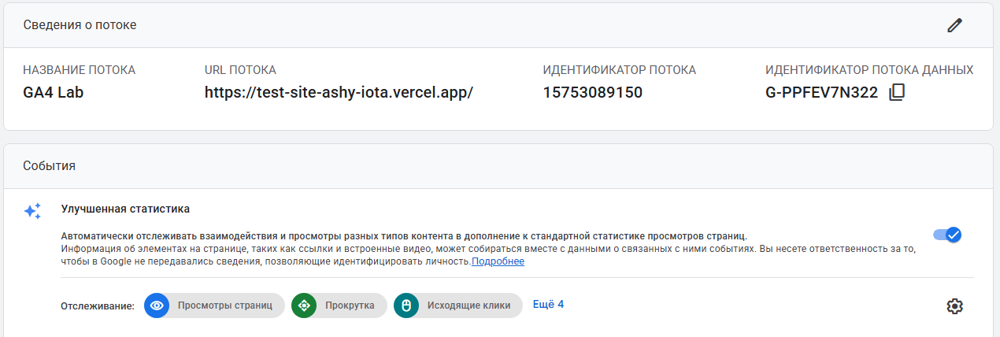
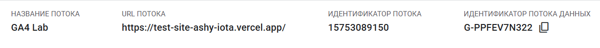

# Домашняя работа № 2 · Где бизнес теряет клиентов

**Дисциплина:** ОП.03 «Информационные технологии»

| Поле | Значение |
|---|---|
| Фамилия, имя, отчество | Зотов Владислав Сергеевич |
| Группа | 25/9/3 |
| Номер работы | 2 |
| Тема работы | Анализ воронки цифрового продукта и структура Google Analytics 4 |
| Дата сдачи | 25.09.2026 |
| Ветка | `main` |

---

# Часть 1. Исследование воронки

## 1.1. Объект исследования

| Поле | Значение |
|---|---|
| Компания, сервис или отрасль | Додо Пицца (доставка еды) |
| Адрес сайта или приложения | https://dodopizza.ru/ |
| Целевое действие | Оформление и оплата заказа |
| Почему выбран этот объект | Массовый сервис с классической воронкой продаж и частыми сценариями брошенной корзины. |

## 1.2. Воронка

| № | Этап | Что считается переходом дальше | Метрика этапа |
|---|---|---|---|
| 1 | Меню | Клик на карточку пиццы | % перехода в товар |
| 2 | Карточка товара | Нажатие «Добавить в корзину» | Конверсия в добавление |
| 3 | Корзина | Нажатие «К оформлению» | % перехода к чекауту |
| 4 | Оформление | Адрес и время доставки указаны, пользователь переходит к оплате | Доля переходов к оплате среди начавших оформление |
| 5 | Оплата | Платёж прошёл, заказ подтверждён | Доля оплаченных заказов среди перешедших к оплате |

## 1.3. Источники

### Источник 1

| Поле | Значение |
|---|---|
| Название материала | Как интернет-магазины используют «Дадату» |
| Автор или организация | DaData, база знаний |
| Дата публикации | На странице не указана |
| Прямая ссылка | https://support.dadata.ru/knowledge-bases/4/articles/12731-kak-internet-magazinyi-ispolzuyut-dadatu |

**Выписка из материала:**

> автозаполнение сокращает ручной ввод; приведён отзыв представителя Ozon о заполнении реквизитов по ИНН.

**Что подтверждает и как связано с моей воронкой:**

> этап 4, оформление. Для доставки еды применим принцип сокращения ручного ввода, но эффект нужно проверить отдельно.

**Цифры из источника и этап воронки, к которому относятся:**

> в отзыве Ozon указаны прирост новых клиентов-юрлиц на 13% и рост конверсии формы среди старых клиентов на 2%. Тип изменения (проценты или процентные пункты) не уточнён; это не показатели «Додо».

### Источник 2

| Поле | Значение |
|---|---|
| Название материала | Самый подробный гайд по тактике «Брошенная корзина» |
| Автор или организация | Наталья Зубова, EMAILMATRIX / Agency EMX, vc.ru |
| Дата публикации | 29.01.2021 |
| Прямая ссылка | https://vc.ru/marketing/201902-samyi-podrobnyi-gaid-po-taktike-broshennaya-korzina |

**Выписка из материала:**

> на примере Lamoda разобрана цепочка писем: напоминание, срочность, специальное предложение.

**Что подтверждает и как связано с моей воронкой:**

> этап 3, корзина. Можно проверить возврат к сохранённому заказу через напоминание.

**Цифры из источника и этап воронки:**

> в примере последнего письма Lamoda скидка 10% действует 3 дня. Это условия предложения, а не прирост конверсии. Точные результаты цепочки Lamoda не опубликованы.

### Источник 3

| Поле | Значение |
|---|---|
| Название материала | Все о Системе быстрых платежей для бизнеса |
| Автор или организация | ЮKassa |
| Дата публикации | 27.06.2023, обновлено 27.06.2025 |
| Прямая ссылка | https://yookassa.ru/recipes/start-biznesa/vse-o-sisteme-bystryh-platezhej-dlya-biznesa/ |

**Выписка из материала:**

> СБП позволяет оплачивать заказ через приложение банка по QR-коду без ручного ввода реквизитов карты.

**Что подтверждает и как связано с моей воронкой:**

> этап 5, оплата. Альтернативный способ оплаты может помочь клиенту завершить заказ; статья не доказывает рост конверсии у «Додо».

**Цифры из источника и этап воронки:**

> в статье указана комиссия 0,2–0,7%. Это стоимость приёма платежа для бизнеса в версии материала, а не доля успешных оплат и не текущий тариф конкретного продавца.

### Источник 4

| Поле | Значение |
|---|---|
| Название материала | Как работать с адресами, чтобы больше заработать и гарантированно доставить товары |
| Автор или организация | Влад Ищук, DaData |
| Дата публикации | 02.09.2021 |
| Прямая ссылка | https://dadata.ru/blog/instructions/best-practises-address/ |

**Выписка из материала:**

> адрес удобно вводить одним полем; нужно сохранять возможность ручного ввода и корректно хранить части адреса.

**Что подтверждает и как связано с моей воронкой:**

> этап 4. Неполные подсказки или отклонение существующего адреса могут мешать оформлению доставки.

**Цифры из источника и этап воронки:**

> количественного результата для «Додо» нет. Применимость рекомендаций проверяется временем заполнения и долей ошибок адресной формы.

### Источник 5

| Поле | Значение |
|---|---|
| Название материала | Маркетологу. Сценарий «Брошенная корзина»: вопросы, которые стоит задавать |
| Автор или организация | Mindbox |
| Дата публикации | 21.11.2016 |
| Прямая ссылка | https://mindbox.ru/journal/education/abandoned-cart-qa/ |

**Выписка из материала:**

> незавершённый заказ может быть связан как с отвлечением человека, так и с проблемами сайта или недоступной доставкой; результат коммуникаций следует проверять экспериментом.

**Что подтверждает и как связано с моей воронкой:**

> этапы 3–5. Одного факта ухода недостаточно, чтобы установить причину.

**Цифры из источника и этап воронки:**

> точные показатели «Додо» в материале не приведены. Для исследования нужны переходы из корзины к оформлению и успешной оплате.

## 1.4. Реальные кейсы

### Кейс 1

| № | Пункт | Ответ |
|---|---|---|
| 1 | Компания, продукт или рынок | Ozon, российский интернет-магазин, заказы юрлиц. |
| 2 | Как выглядела воронка или её проблемный участок | Заполнение реквизитов в форме заказа. |
| 3 | В чём заключалась проблема | Корпоративному покупателю нужно вручную вводить много данных. |
| 4 | Какие данные или наблюдения подтвердили проблему | В материале DaData приведён отзыв Анастасии Молчановой, экс-менеджера продукта Ozon. |
| 5 | Что изменили или протестировали | Ввод реквизитов по ИНН. |
| 6 | Как изменился результат | Заявлены +13% новых клиентов-юрлиц и +2% конверсии формы у старых клиентов. Методика расчёта в отзыве не раскрыта. |
| 7 | Переносим ли подход на мой объект | Для «Додо» проверять сокращение ручного ввода адреса; численный эффект Ozon переносить нельзя. |

**Ссылка на источник кейса:**

> https://support.dadata.ru/knowledge-bases/4/articles/12731-kak-internet-magazinyi-ispolzuyut-dadatu

### Кейс 2

| № | Пункт | Ответ |
|---|---|---|
| 1 | Компания, продукт или рынок | Lamoda, российский e-commerce. |
| 2 | Как выглядела воронка или её проблемный участок | Товар в корзине → завершённая покупка. |
| 3 | В чём заключалась проблема | Покупатель не завершает заказ. |
| 4 | Какие данные или наблюдения подтвердили проблему | Автор материала показывает реальные письма цепочки Lamoda; причины ухода конкретных клиентов не установлены. |
| 5 | Что изменили или протестировали | Напоминание о товарах, сообщение о срочности, затем предложение скидки. |
| 6 | Как изменился результат | Точные показатели в открытом источнике не приведены. Общую статистику email-маркетинга нельзя считать результатом Lamoda. |
| 7 | Переносим ли подход на мой объект | Для доставки еды проверить одно своевременное напоминание; многодневная цепочка может оказаться неуместной. |

**Ссылка на источник кейса:**

> https://vc.ru/marketing/201902-samyi-podrobnyi-gaid-po-taktike-broshennaya-korzina

## 1.5. Причины потери пользователей

| № | Этап воронки | Причина потери | Какой источник это подтверждает |
|---|---|---|---|
| 1 | 3 — корзина | Человек отвлёкся и не вернулся к заказу. | Источники 2 и 5: сценарии возврата к незавершённой покупке. |
| 2 | 4 — оформление | Долгий ввод или ошибки адреса мешают продолжить заказ. | Источники 1 и 4: сокращение ручного ввода и обработка адресов. |
| 3 | 5 — оплата | Доступный способ оплаты неудобен клиенту. | Источник 3 описывает альтернативу вводу карты; связь с отказами требует проверки по данным оплат. |

## 1.6. Гипотезы улучшения

| № | Этап | Гипотеза | Какие данные нужно собрать | Как проверить, сработало |
|---|---|---|---|---|
| 1 | 3 | Одно напоминание через 30 минут поможет вернуть часть незавершённых заказов. | Корзины без оплаты, доставки сообщений, покупки после напоминания, отписки. | Случайно разделить подходящих клиентов с согласием на коммуникации на две группы; сравнить долю оплаченных заказов за одинаковое окно времени. |
| 2 | 4 | Удобные подсказки адреса с ручным вводом при отсутствии подходящего варианта сократят потери. | Начала заполнения, ошибки адреса, время заполнения, переходы к оплате. | A/B-тест текущей и изменённой формы; основной показатель — переход к оплате, дополнительный — доля ошибок доставки. |
| 3 | 5 | Более понятный выбор способов оплаты повысит долю успешных заказов. | Показы способов оплаты, выбор способа, успешные платежи, ошибки. | A/B-тест представления способов оплаты; сравнить долю оплат среди начавших этот этап, учитывая тип устройства. |

---

# Часть 2. Google Analytics 4

## 2.1. Пройденные шаги

| № | Шаг | Выполнено |
|---|---|---|
| 1 | Вход в Google Analytics под своим аккаунтом | да |
| 2 | Создан Analytics Account | да |
| 3 | Создан Property | да |
| 4 | Выбраны часовой пояс, валюта и общие сведения | да |
| 5 | Выбраны бизнес-цели | да |
| 6 | Создан ресурс | да |
| 7 | Создан Web Data Stream | да |
| 8 | Проверены Website URL, Stream name, Enhanced Measurement | да |
| 9 | Поток создан | да |
| 10 | Найден Measurement ID | да |

## 2.2. Что получилось

| Поле | Значение |
|---|---|
| Analytics Account | Resolushh |
| Property | Resolushh |
| Reporting time zone | GMT+03:00 |
| Currency | Российский рубль (RUB) |
| Выбранные бизнес-цели | Анализ трафика сайта и/или приложения, Стимулирование продаж, Привлечение лидов, Просмотр данных о взаимодействиях и удержании пользователей |
| Stream name | GA4 Lab |
| Website URL | https://test-site-ashy-iota.vercel.app/ |
| Stream ID (числовой) | 15753089150 |
| Measurement ID (`G-…`) | G-PPFEV7N322 |
| Enhanced Measurement | включено |

Stream ID и Measurement ID — это разные идентификаторы. На сайт в задании 3
ставится второй, вида `G-XXXXXXXXXX`.

## 2.3. Скриншоты

---

## Использование ИИ

| Вопрос | Ответ |
|---|---|
| Что сделано самостоятельно | Выбран объект исследования — «Додо Пицца»; выполнена первоначальная настройка GA4 и собраны имеющиеся скриншоты. |
| Что спрошено у модели | Помощь с правками, проверкой работы и оформлением отчёта. |
| Что после этого проверено и изменено | Уточнил формулировки, исправил неточности и сверил текст с имеющимися материалами. |
