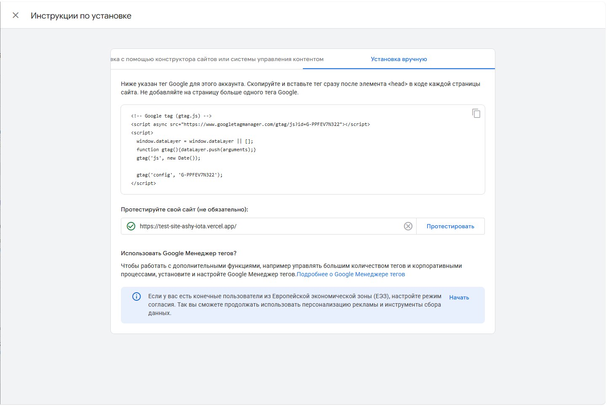
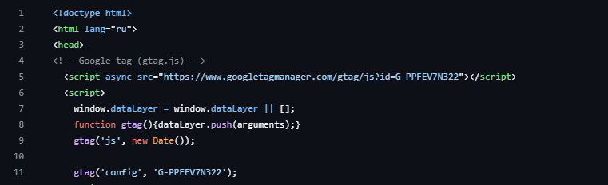
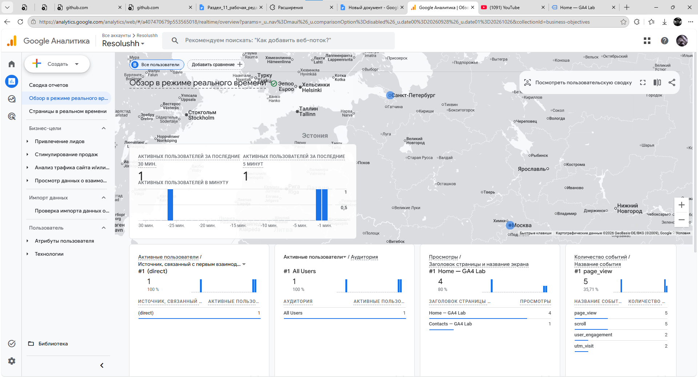
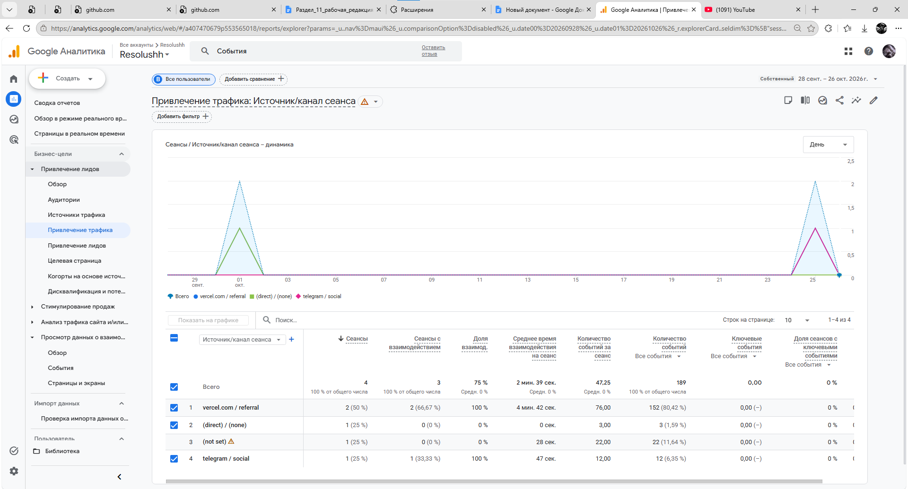
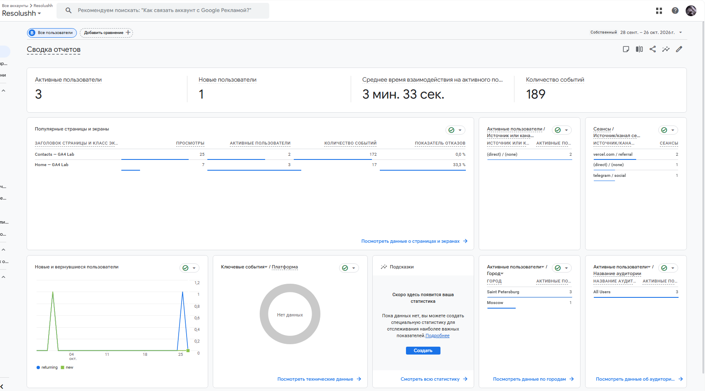
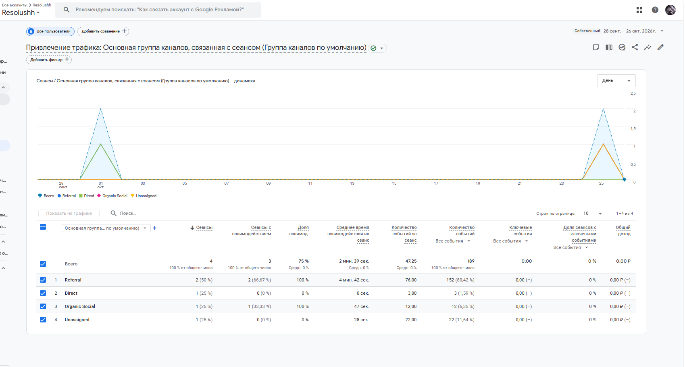
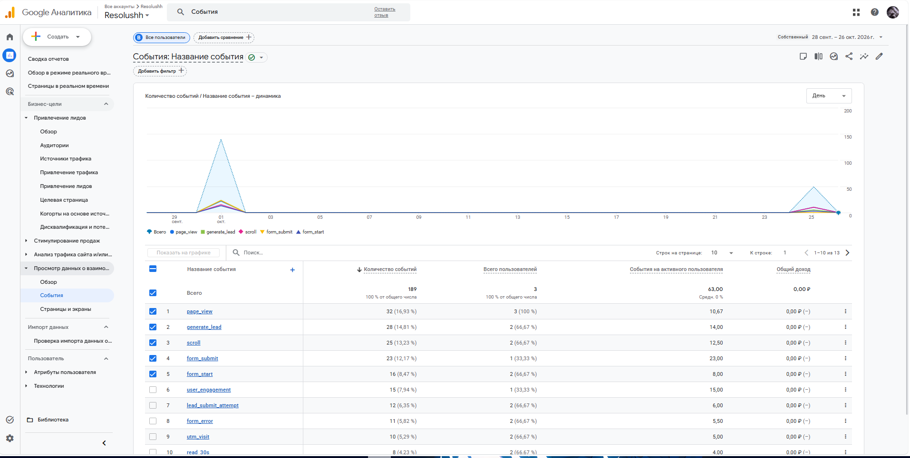

# Домашняя работа № 3 · Тег на сайте, источник и отчёты GA4

**Дисциплина:** ОП.03 «Информационные технологии»

| Поле | Значение |
|---|---|
| Фамилия, имя, отчество | Зотов Владислав Сергеевич |
| Группа | РПО 9/25/3 |
| Номер работы | 3 |
| Тема работы | Установка Google Tag, источник перехода и отчёты GA4 |
| Дата сдачи | 25.09.2026 |
| Ветка | `main` |

---

## 1. Мой сайт и мой ресурс

| Поле | Значение |
|---|---|
| Адрес репозитория сайта | https://github.com/Resolushh/test_site |
| Публичный адрес сайта | https://test-site-ashy-iota.vercel.app/ |
| Статус публикации | READY |
| Analytics Account | Resolushh |
| Property | Resolushh |
| Stream name | GA4 Lab |
| Website URL в потоке | https://test-site-ashy-iota.vercel.app/ |
| Measurement ID (`G-…`) | G-PPFEV7N322 |
| Страницы с тегом | `index.html` `contacts.html` `about.html` |

Тег ставится на каждую страницу по одному разу: две копии дают двойные
события.

## 2. Тег установлен

**Результат проверки из инструкции тега:**

> Проверка сайта в инструкции ручной установки завершилась зелёной отметкой. На кадре видны адрес https://test-site-ashy-iota.vercel.app/ и Measurement ID G-PPFEV7N322.





## 3. События доходят до аналитики

| Поле | Значение |
|---|---|
| Дата и время проверки | 26.10.2026; Realtime за последние 30 минут, точное время на кадре не показано |
| Какие страницы открывали | Home — GA4 Lab и Contacts — GA4 Lab |
| Какие события появились в Realtime | `page_view` (5), `scroll` (5), `user_engagement` (2), `utm_visit` (2) |
| Число активных пользователей в момент проверки | 1 за последние 30 минут; 1 за последние 5 минут |



## 4. Источник перехода определился

**Ссылка целиком:**

```
https://test-site-ashy-iota.vercel.app/?utm_source=telegram&utm_medium=social&utm_campaign=hw3_test
```

| Поле | Значение |
|---|---|
| Где в GA4 виден источник | Отчёт «Привлечение трафика», измерение «Источник/канал сеанса» |
| Какое значение источника показал GA4 | telegram / social; в этой строке показан 1 сеанс |
| Совпадает с `utm_source` из ссылки | Источник telegram и канал social совпадают с метками ссылки; кампания на этом кадре не показана |



На кадре видны ресурс Resolushh, период 28.09.2026–26.10.2026
и источник telegram / social. Значение кампании в этом разрезе не показано.

## 5. Статистика на странице «Отчёты»

| Показатель | Значение | Период |
|---|---|---|
| Пользователи | 3 активных | 28.09.2026–26.10.2026 |
| Сеансы | 4, итоговая строка отчёта «Привлечение трафика» | 28.09.2026–26.10.2026 |
| События | 189 | 28.09.2026–26.10.2026 |
| Самое частое событие | page_view — 32 срабатывания | 28.09.2026–26.10.2026 |







**Что видно по этим числам:**

> За период 28 сентября — 26 октября в отчётах 3 активных пользователя, 4 сеанса и 189 событий. У Contacts — 25 просмотров, у Home — 7. Среднее время взаимодействия на активного пользователя — 3 мин. 33 сек. Самое частое событие — page_view, 32 срабатывания. Это результаты тестовых посещений.

## 6. Что не получилось

Дополнительные нерешённые проблемы в сохранённых материалах этой работы не указаны.

## 7. Использование ИИ

| Вопрос | Ответ |
|---|---|
| Что сделано самостоятельно | Подключение тега к сайту, публикация сайта и сбор имеющихся скриншотов GA4. |
| Что спрошено у модели | Помощь с правками, проверкой работы и оформлением отчёта. |
| Что после этого изменено | Уточнил формулировки, исправил неточности и сверил текст с имеющимися материалами. |
