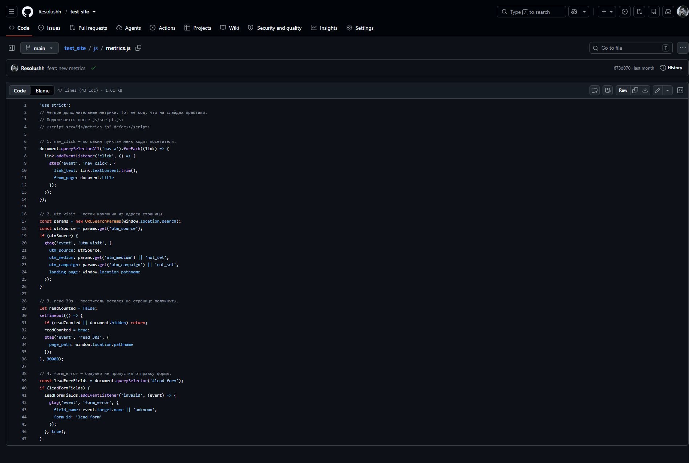
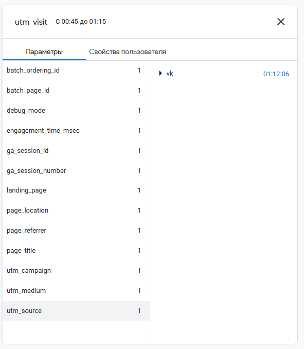
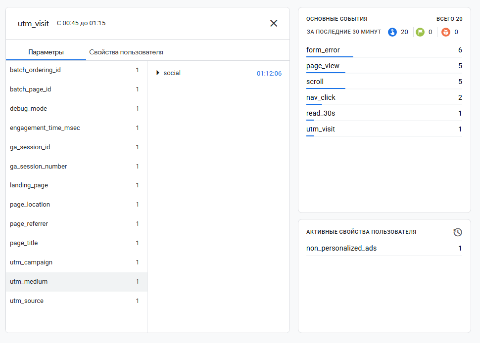
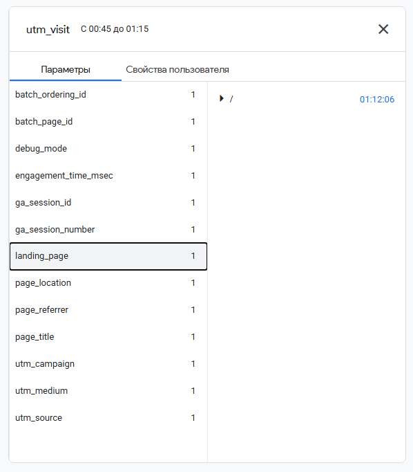

# Домашняя работа № 4 · Свои события и параметры в GA4

**Дисциплина:** ОП.03 «Информационные технологии»

| Поле | Значение |
|---|---|
| Фамилия, имя, отчество | Зотов Владислав Сергеевич |
| Группа | 25/9/3 |
| Номер работы | 4 |
| Тема работы | Свои события и параметры: четыре метрики на сайте |
| Дата сдачи | 25.09.2026 |
| Ветка | `main` |

---

## 1. Мой сайт и мой ресурс

| Поле | Значение |
|---|---|
| Публичный адрес сайта | https://test-site-ashy-iota.vercel.app/ |
| Measurement ID (`G-…`) | G-PPFEV7N322 |
| Коммит с метриками (ссылка или первые 7 символов) | [https://github.com/Resolushh/test_site/commit/673d07040c58916c7bf038b8b123fbee11a72372](https://github.com/Resolushh/test_site/commit/673d07040c58916c7bf038b8b123fbee11a72372) |
| Статус публикации | READY |
| Страницы, где подключён `js/metrics.js` | `index.html` `contacts.html` `about.html` |

Файл подключается после основного скрипта и на каждой странице по одному
разу: два подключения дают двойные события.

## 2. Какие метрики добавлены

| Событие | Что измеряет | Что делали, чтобы оно сработало |
|---|---|---|
| `nav_click` | клики по пунктам меню | Кликали по ссылкам в навигационном меню сайта. |
| `utm_visit` | метки кампании из адреса | Переходили на сайт по ссылке с заданными UTM-метками. |
| `read_30s` | полминуты на странице | Оставляли вкладку с сайтом открытой и активной минимум 30 секунд. |
| `form_error` | форма не прошла проверку браузера | Пытались отправить форму с незаполненными обязательными полями или ошибками валидации. |




## 3. События в DebugView

| Поле | Значение |
|---|---|
| Дата и время проверки | 26.10.2026, около 01:12 по времени в DebugView |
| Как подключали отладку | Tag Assistant |
| Какие из четырёх событий пришли | В DebugView видны все четыре события: form_error — 6, nav_click — 2, read_30s — 1, utm_visit — 1 |
| Какие не пришли и почему | Все четыре события пришли; отсутствующих нет |


## 4. Параметры события `utm_visit`

**Ссылка, по которой открывали сайт:**

```
https://test-site-ashy-iota.vercel.app/?utm_source=vk&utm_medium=social&utm_campaign=hw4_test
```

| Параметр | Значение в ссылке | Значение в GA4 |
|---|---|---|
| `utm_source` | vk | vk |
| `utm_medium` | social | social |
| `utm_campaign` | hw4_test | hw4_test |
| `landing_page` | — | / |








> Метки передались без изменений: vk / social / hw4_test. На отдельных кадрах раскрыты параметры одного события utm_visit со временем 01:12:06. Параметр landing_page=/ передаёт скрипт metrics.js.

## 5. Событие вне отладки

| Поле | Значение |
|---|---|
| Где проверяли | Realtime |
| Какое событие искали | `nav_click` |
| Сколько срабатываний показал экран | 2 |
| Период (для отчёта) | Последние 30 минут |


## 6. Что эти метрики показывают про сайт

> В DebugView записались 6 событий form_error, 2 nav_click, по одному read_30s и utm_visit. Сработали проверка формы, клики по меню, ожидание 30 секунд и чтение меток. Чтобы сравнить популярность разделов, нужны значения link_text. Отдельный кадр Realtime подтверждает 2 события nav_click вне отладки.

## 7. Что не получилось

## 8. Использование ИИ

| Вопрос | Ответ |
|---|---|
| Что сделано самостоятельно | Подключение metrics.js, публикация сайта, тестирование событий и сбор имеющихся скриншотов GA4. |
| Что спрошено у модели | Помощь с правками, проверкой работы и оформлением отчёта. |
| Что после этого изменено | Уточнил формулировки, исправил неточности и сверил текст с имеющимися материалами. |
