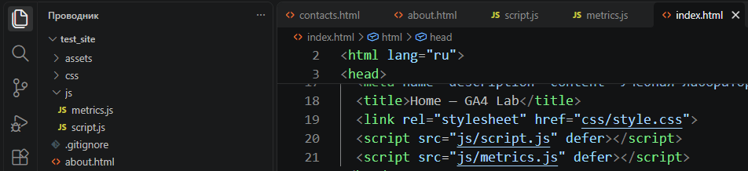
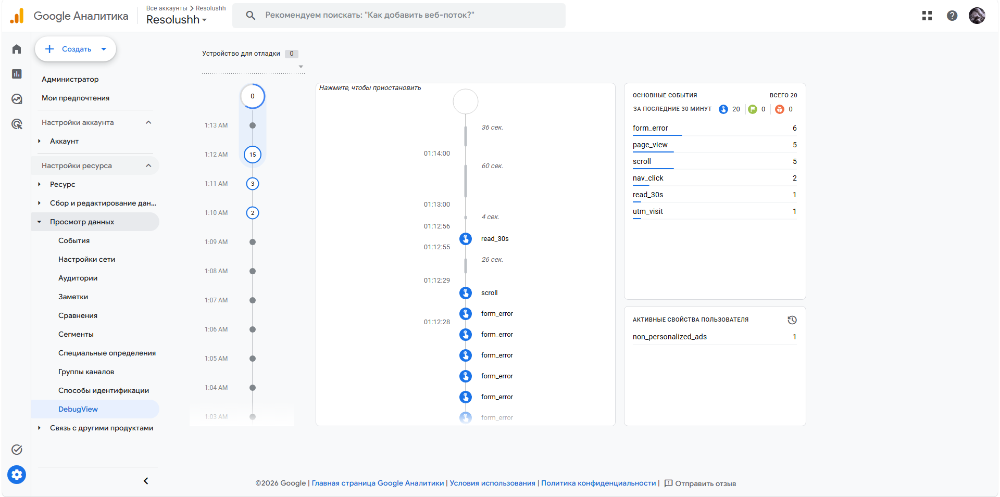
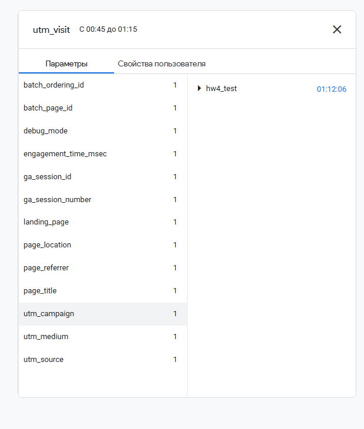
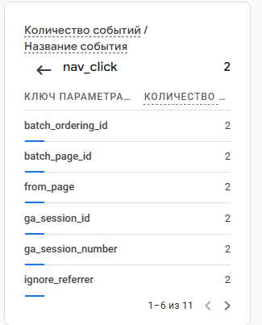

# Домашняя работа № 4 · Свои события и параметры в GA4

**Дисциплина:** ОП.03 «Информационные технологии»

| Поле | Значение |
|---|---|
| Фамилия, имя, отчество | Зотов Владислав Сергеевич |
| Группа | 25/9/3 |
| Номер работы | 4 |
| Тема работы | Свои события и параметры: четыре метрики на сайте |
| Дата сдачи | 25.09.2026 |
| Ветка | `hw-04` |

---

## 1. Мой сайт и мой ресурс

| Поле | Значение |
|---|---|
| Публичный адрес сайта | https://test-site-ashy-iota.vercel.app/ |
| Measurement ID (`G-…`) | G-PPFEV7N322 |
| Коммит с метриками (ссылка или первые 7 символов) | [https://github.com/Resolushh/test_site/commit/673d07040c58916c7bf038b8b123fbee11a72372](https://github.com/Resolushh/test_site/commit/673d07040c58916c7bf038b8b123fbee11a72372) |
| Статус публикации | READY |
| Страницы, где подключён `js/metrics.js` | `index.html` `contacts.html` `about.html` |

Файл подключается после основного скрипта и на каждой странице по одному
разу: два подключения дают двойные события.

## 2. Какие метрики добавлены

| Событие | Что измеряет | Что делали, чтобы оно сработало |
|---|---|---|
| `nav_click` | клики по пунктам меню | Кликали по ссылкам в навигационном меню сайта. |
| `utm_visit` | метки кампании из адреса | Переходили на сайт по ссылке с заданными UTM-метками. |
| `read_30s` | полминуты на странице | Оставляли вкладку с сайтом открытой и активной минимум 30 секунд. |
| `form_error` | форма не прошла проверку браузера | Пытались отправить форму с незаполненными обязательными полями или ошибками валидации. |



## 3. События в DebugView

| Поле | Значение |
|---|---|
| Дата и время проверки | 25.09.2026 22:45 |
| Как подключали отладку | Tag Assistant |
| Какие из четырёх событий пришли | В Realtime подтверждены utm_visit, read_30s и form_error на кадре 02, nav_click — на кадре 04; лента DebugView не приложена |
| Какие не пришли и почему | На кадре 02 нет nav_click, причина не установлена. Вместо DebugView приложена карточка Realtime; нужен новый кадр всех четырёх событий в DebugView |



## 4. Параметры события `utm_visit`

**Ссылка, по которой открывали сайт:**

```
https://test-site-ashy-iota.vercel.app/?utm_source=vk&utm_medium=social&utm_campaign=hw4_test
```

| Параметр | Значение в ссылке | Значение в GA4 |
|---|---|---|
| `utm_source` | vk | vk |
| `utm_medium` | social | social |
| `utm_campaign` | hw4_test | Начинается с hw4_test и содержит фрагмент Markdown-ссылки; полное значение обрезано, совпадение не подтверждено |
| `landing_page` | — | / |



> На кадре у utm_campaign после hw4_test виден фрагмент Markdown-ссылки. Вероятно, в адресную строку была вставлена разметка вместе с URL. Для повторной проверки нужно скопировать только адрес из блока выше. utm_source=vk и utm_medium=social показаны правильно. landing_page=/ передаётся скриптом metrics.js из window.location.pathname, а не определяется автоматически аналитикой.

## 5. Событие вне отладки

| Поле | Значение |
|---|---|
| Где проверяли | Realtime |
| Какое событие искали | `nav_click` |
| Сколько срабатываний показал экран | 2 |
| Период (для отчёта) | Последние 30 минут |



## 6. Что эти метрики показывают про сайт

> На кадре 02 получены 4 события form_error, по одному read_30s и utm_visit: сработали проверка полей, ожидание 30 секунд и обработка меток. Кадр 04 показывает 2 события nav_click, но без значений link_text нельзя определить, какой раздел нажимали чаще. Это учебная проверка, а не доказательство проблем реальных посетителей с формой.

## 7. Что не получилось

> Первоначально сообщалось о проблемах с DebugView и nav_click; рассматривались защита Edge и прерывание отправки при навигации, пробовалось открытие ссылок с Ctrl. Причина сбоя по кадрам не установлена. Вместо DebugView приложен Realtime, utm_campaign содержит лишний фрагмент Markdown. Код обработчиков проверен в репозитории сайта; кадр 01 показывает подключение, но не содержимое metrics.js. Новые проверки и скриншоты отложены.

## 8. Использование ИИ

| Вопрос | Ответ |
|---|---|
| Что сделано самостоятельно | Интеграция скрипта `js/metrics.js` на страницы сайта, деплой на Vercel, обход блокировок трекинга браузером, тестирование событий через Tag Assistant и сбор скриншотов из GA4. |
| Что спрошено у модели | Проверка бланка, исправление Markdown, помощь с nav_click и сверка текста с кодом сайта и имеющимися кадрами. |
| Что после этого изменено | Вставлена чистая UTM-ссылка в закрытый блок кода. Realtime отделён от неподтверждённого DebugView, исправлено описание landing_page и значения кампании, выводы основаны на тестовых событиях. Сохранена исходная структура бланка. |
