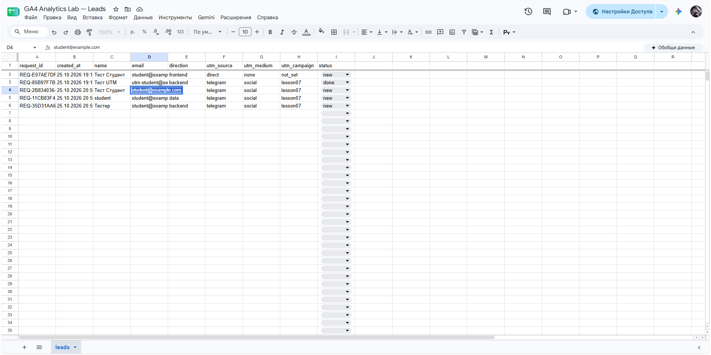
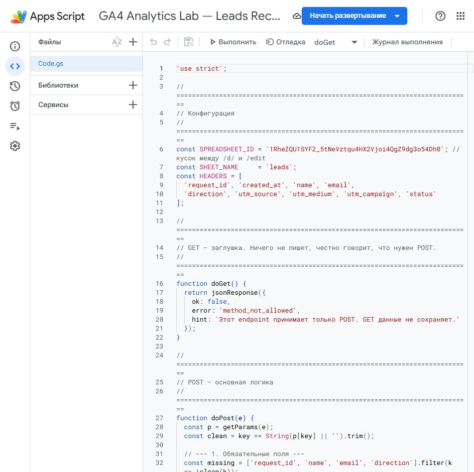
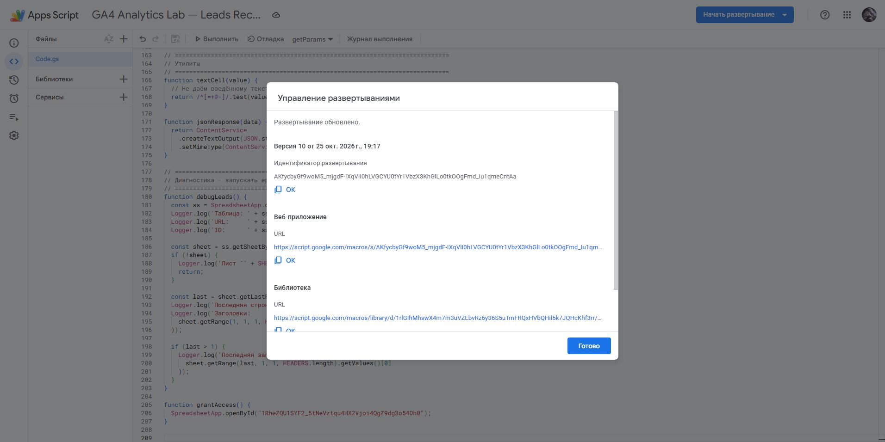
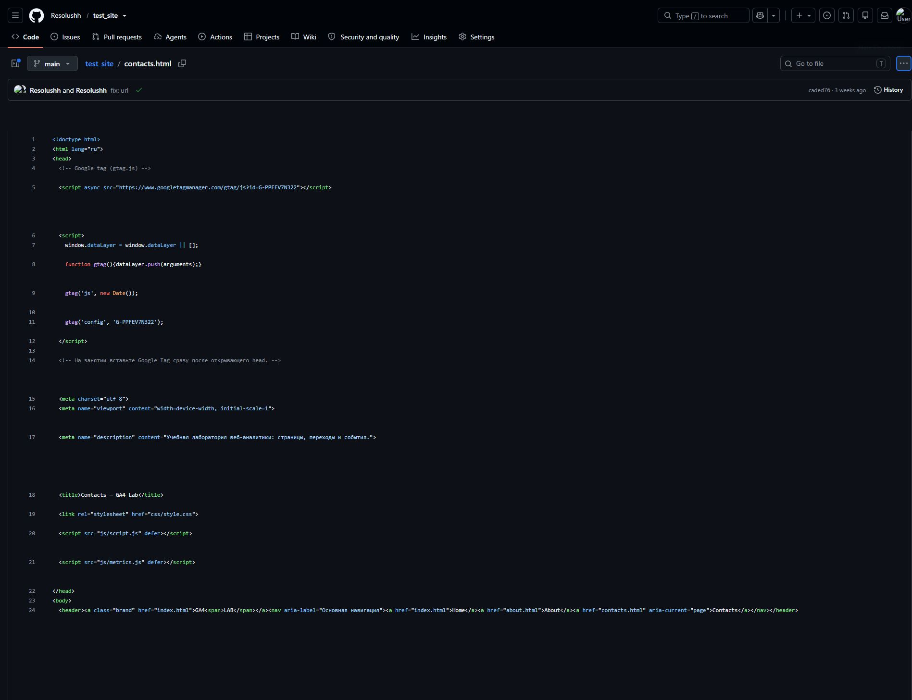
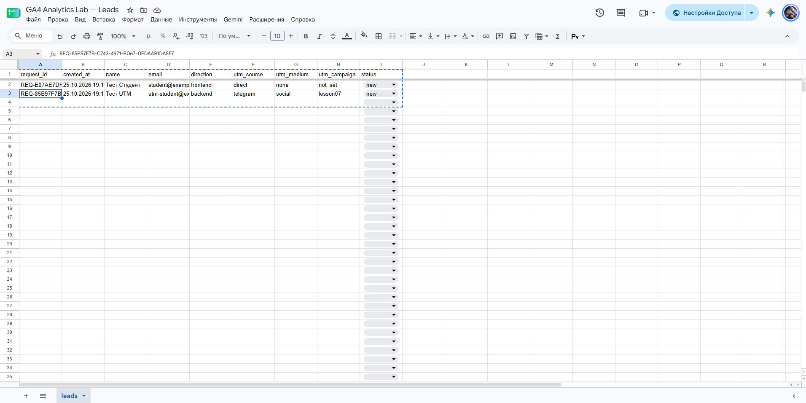
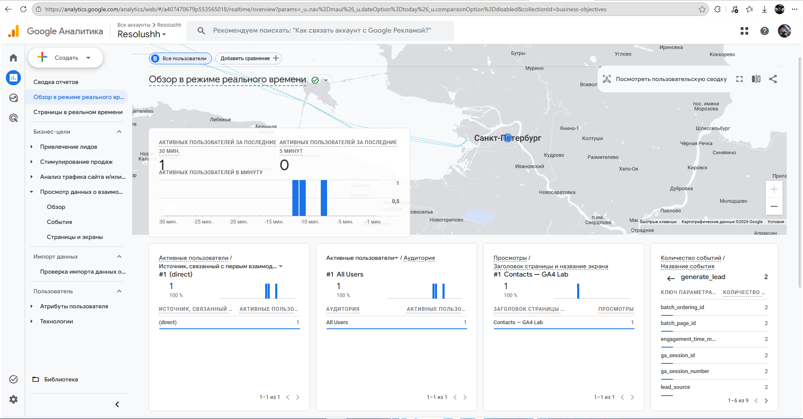
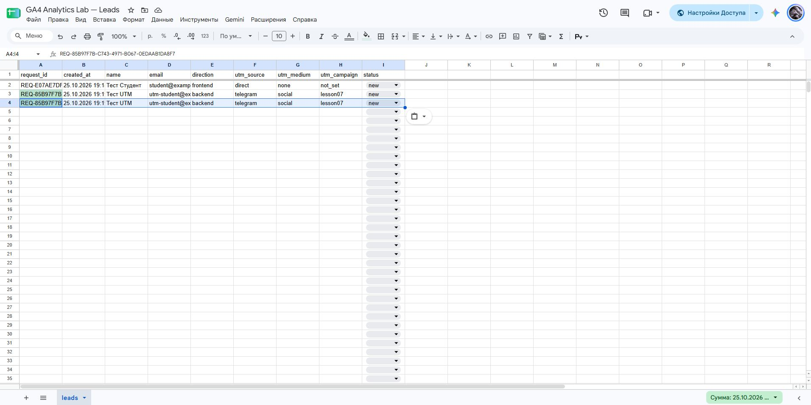
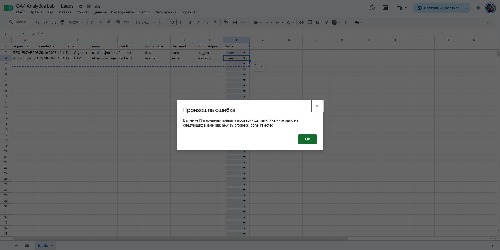

# Домашняя работа № 5 · Контролируемая таблица заявок

**Дисциплина:** ОП.03 «Информационные технологии»

| Поле | Значение |
|---|---|
| Фамилия, имя, отчество | Зотов Владислав Сергеевич |
| Группа | РПО 9/25/3 |
| Номер работы | 5 |
| Тема работы | Форма сайта → Apps Script → Google Таблица заявок |
| Дата сдачи | 25.10.2026 |

---

## 1. Таблица

Я создал таблицу «GA4 Analytics Lab — Leads» с листом `leads`. В первой
строке девять заголовков: `request_id`, `created_at`, `name`, `email`,
`direction`, `utm_source`, `utm_medium`, `utm_campaign`, `status`. Строка
заголовков закреплена, у статуса список из четырёх значений: `new`,
`in_progress`, `done`, `rejected`. Два правила подсвечивают неполную строку
и повторный `request_id`.

Ссылка на таблицу: [Таблица заявок](https://docs.google.com/spreadsheets/d/1RheZQU1SYF2_5tNeVztqu4HX2Vjoi4QgZ9dg3o54Dh0/edit)

## 2. Приёмник и форма

Я вставил `Code.gs` из материалов в Apps Script, указал ID своей таблицы
и опубликовал проект как Web app. Форму в `contacts.html` заменил
фрагментом из материалов, в `action` поставил адрес своего Web app,
обработчик формы в `js/script.js` заменил новым.

| Мои данные | Значение |
|---|---|
| Публичный адрес сайта | https://test-site-ashy-iota.vercel.app/ |
| Measurement ID (`G-…`) | G-PPFEV7N322 |
| Коммит с новой формой (первые 7 символов) | `8c55e56` — добавление формы; `33453df` — текущий обработчик; `caded76` — актуальный адрес приёмника |

## 3. Две тестовые заявки

Первую заявку я отправил со страницы без меток: в таблице записалось
`direct` / `none` / `not_set` и статус `new`. Вторую отправил по ссылке
с метками `telegram` / `social` / `lesson07`, и они записались в свои
столбцы.

| | Заявка без меток | Заявка с метками |
|---|---|---|
| `request_id` | REQ-E07AE7DF-261E-479B-8B27-D030F0319508 | REQ-85B97F7B-C743-4971-B067-0EDAAB1DA8F7 |

## 4. Событие в аналитике

В GA4 появились два события `generate_lead` — они видны на скриншоте ниже.
В моём обработчике это событие отправляется после успешного ответа
приёмника. Попытка отправки учитывается отдельно как `lead_submit_attempt`,
а сохранение заявки проверяется по строке в таблице.

## 5. Проверки

Форма с пустым именем не отправилась: браузер потребовал заполнить поле.
Повторный запрос с ID первой заявки вернул `duplicate_request_id`,
новая строка не появилась. Этот запрос проверялся напрямую, без формы: после
успешной отправки сайт очищает поля и сбрасывает ID.

Копия строки с тем же `request_id` подсветилась. После скриншота копия
была удалена. Значение `finished` таблица не приняла. Через список статус
второй заявки сменился `new` → `in_progress` → `done`.

---

Не получилось: сначала не сохранялись заявки и не отображались события аналитики. После исправлений всё заработало.

ИИ: использовал для правок, проверки работы и оформления отчёта.
