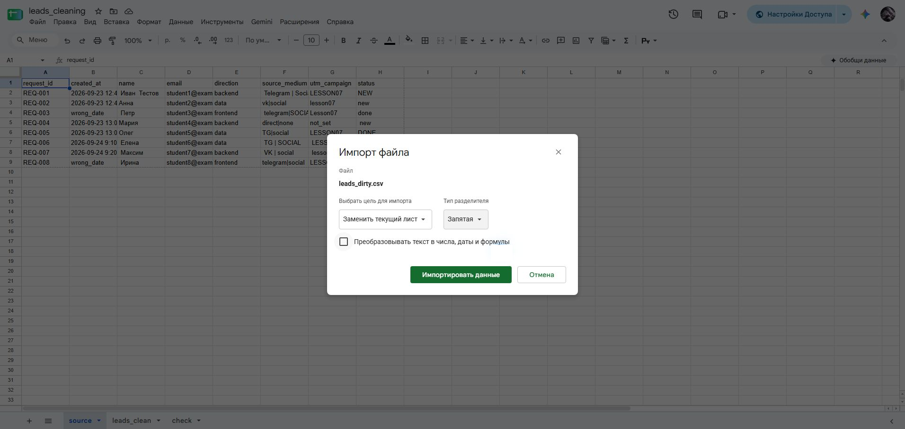
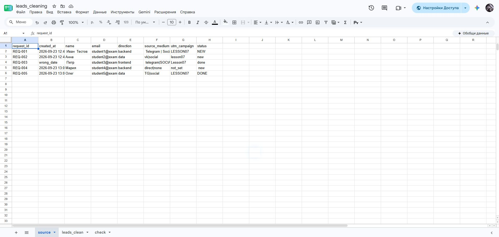
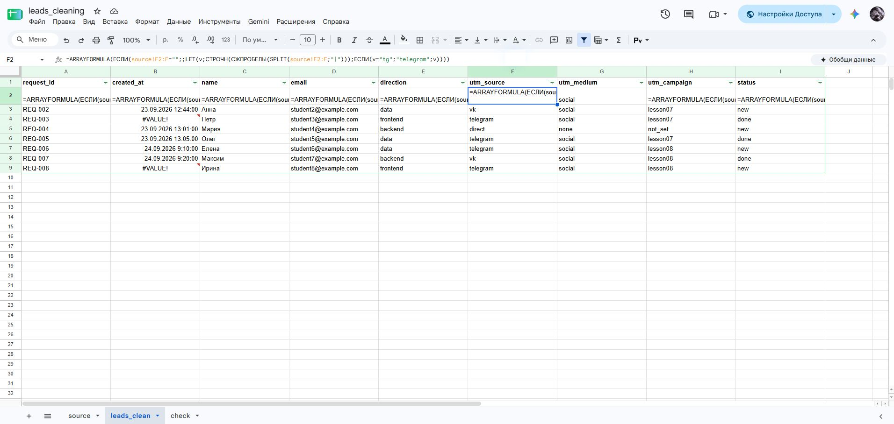
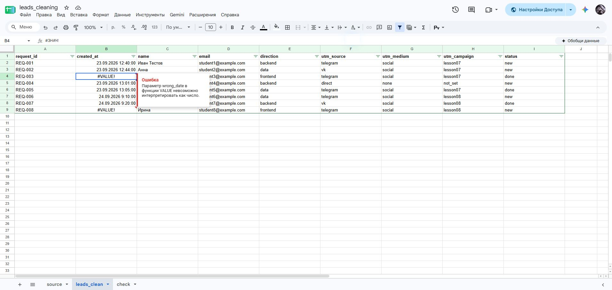
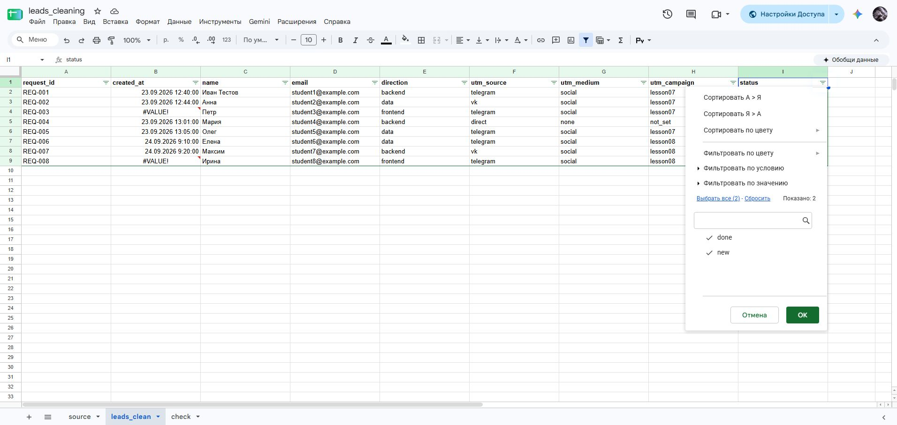
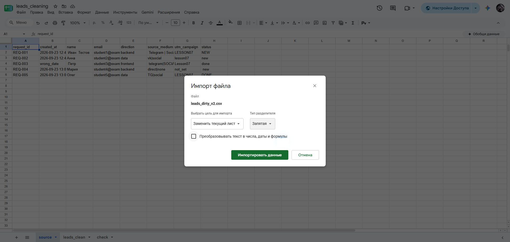
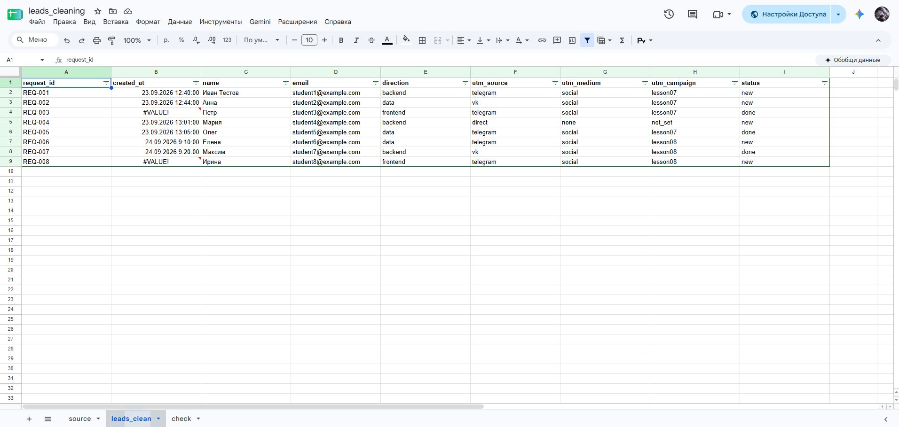
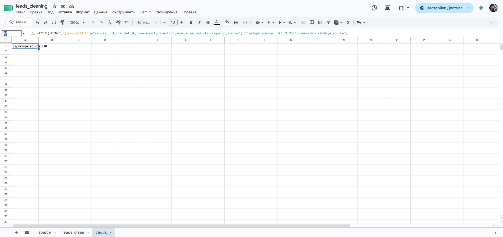
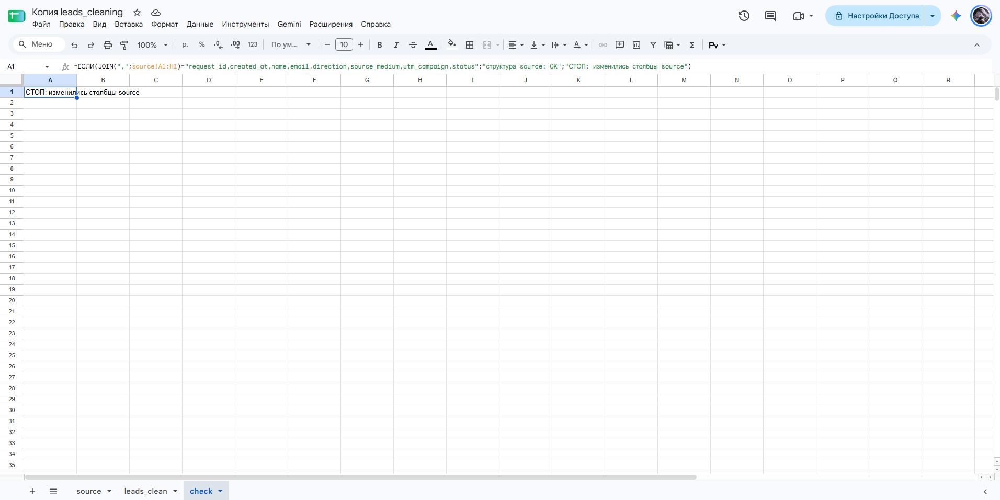

# Домашняя работа № 6 · Подготовка данных в Google Таблицах

**Дисциплина:** ОП.03 «Информационные технологии»

| Поле | Значение |
|---|---|
| Фамилия, имя, отчество | Зотов Владислав Сергеевич |
| Группа | РПО 9/25/3 |
| Номер работы | 6 |
| Тема работы | Повторяемая очистка выгрузки заявок в Google Таблицах |
| Дата сдачи | 25.10.2026 |

---

## 1. Импорт

Я создал таблицу `leads_cleaning` и импортировал `leads_dirty.csv` на лист
`source` с целью «Заменить текущий лист», разделителем «Запятая» и снятым
флажком «Преобразовывать текст в числа, даты и формулы». Данные на `source`
остались такими, как в файле; вручную я их не редактировал.
После проверки первой выгрузки заменил её второй с теми же настройками.

Ссылка для просмотра: [leads_cleaning](https://docs.google.com/spreadsheets/d/18GpSSh0bg7vgubVmqkELt5rZ3H7OA7WwUKCx_OwZr6o/edit?usp=sharing).

## 2. Правила

На листе `leads_clean` девять заголовков и восемь формул ARRAYFORMULA
во второй строке: A2–F2, H2 и I2. Столбец G заполняется из F2 при разделении
источника и канала; отдельная формула в G2 не нужна.
Формулы убирают лишние пробелы, делят
`source_medium` на источник и канал, приводят метки и статус к нижнему
регистру и заменяют `tg` на `telegram`.

## 3. Ошибка и проверка значений

В строке `REQ-003` дата записана как `wrong_date`, поэтому в `created_at`
стоит `#VALUE!`. Я оставил ошибку видимой, чтобы не потерять неверную
запись. В фильтре `status` после очистки только `done` и `new`.

## 4. Вторая выгрузка

Я импортировал `leads_dirty_v2.csv` на тот же лист `source`. Формулы
не менял: в `leads_clean` стало 8 строк вместо 5, ошибочные даты видны
у `REQ-003` и `REQ-008`. Строка `REQ-006` очистилась в
Елена / telegram / social / lesson08 / new.
Результат скачан с листа `leads_clean` через «Файл → Скачать → Формат CSV»
и лежит в этой папке как [leads_clean.csv](leads_clean.csv): 9 столбцов и 8 заявок.
Копия файла сохранена в `lesson_data_cleaning/result/leads_clean.csv`.
Для `created_at` на `leads_clean` выбран формат «Дата и время»,
ошибки `#VALUE!` оставлены видимыми.

## 5. Проверка структуры

На листе `check` формула сравнивает заголовки `source` с ожидаемыми
и показывает «структура source: OK». Если столбцы в CSV переставят,
она покажет «СТОП: изменились столбцы source».

Я проверил это на [копии таблицы](https://docs.google.com/spreadsheets/d/1DQd0pqTqAVDoVXHu2OttwCxY5-tcBB73rgfDGHQUJq8/edit):
заголовок `source_medium` заменён на `traffic`, и проверка показывает «СТОП».
Основная таблица сохраняет правильный заголовок и показывает «OK».

---

Не получилось: дополнительные нерешённые проблемы в сохранённых материалах этой работы не указаны.

ИИ: использовал для правок, проверки работы и оформления отчёта.
