# Домашняя работа № 7 · Instagram → ManyChat → заявка

**Дисциплина:** ОП.03 «Информационные технологии»

| Поле | Значение |
|---|---|
| Фамилия, имя, отчество | Зотов Владислав Сергеевич |
| Группа | 25/9/3 |
| Номер работы | 7 |
| Тема работы | Автоворонка из Instagram: комментарий → сообщение → сайт → заявка |
| Дата сдачи | 27.10.2026 |

---

## 1. Подключение и automation

Я перевёл учебный аккаунт Instagram в профессиональный и подключил его
к ManyChat на тарифе Free. Собрал automation: триггер на комментарий под
выбранной публикацией, ключевое слово `ГАЙД`, публичный ответ, личное
сообщение и кнопка «Получить материал» со ссылкой с UTM. Automation
включена в режиме Live.

Название сценария: [IG — Backend Guide — Reel 01](https://app.manychat.com/fb5843515/cms/files/content20261027012743_077582/edit).

| Мои данные | Значение |
|---|---|
| Учебный аккаунт Instagram | [@resolushh_](https://www.instagram.com/resolushh_/) |
| Ссылка на учебную публикацию | [Пост с чек-листом по backend](https://www.instagram.com/resolushh_/p/De-q85sqlx4/) |
| Публичный адрес сайта | [Учебный сайт](https://test-site-ashy-iota.vercel.app/) |
| Measurement ID (`G-…`) | `G-PPFEV7N322` |

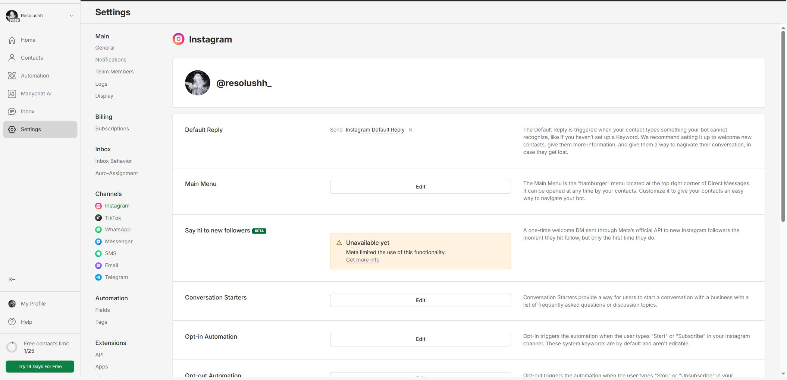

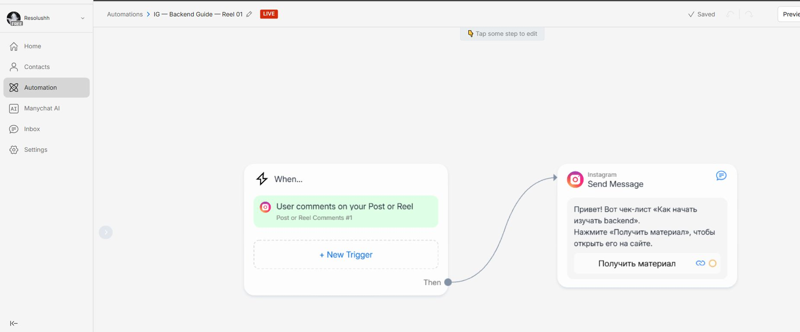

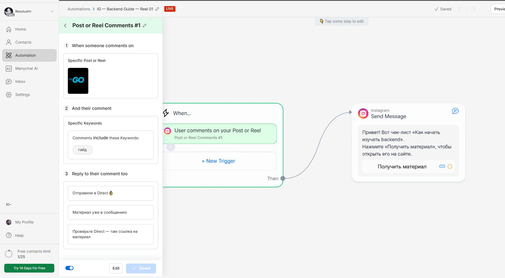

## 2. Тест цепочки

Со второго аккаунта [@vladaghos](https://www.instagram.com/vladaghos/) я оставил комментарий `Гайд`. Под ним появился
автоматический ответ, а в Direct пришло сообщение с кнопкой. Кнопка
открыла `guide.html` с метками в адресе, оттуда я перешёл к форме
и отправил тестовую заявку.

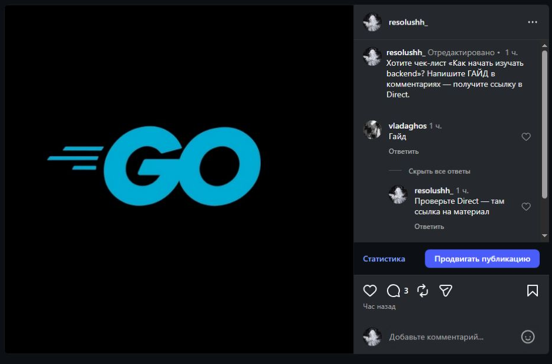

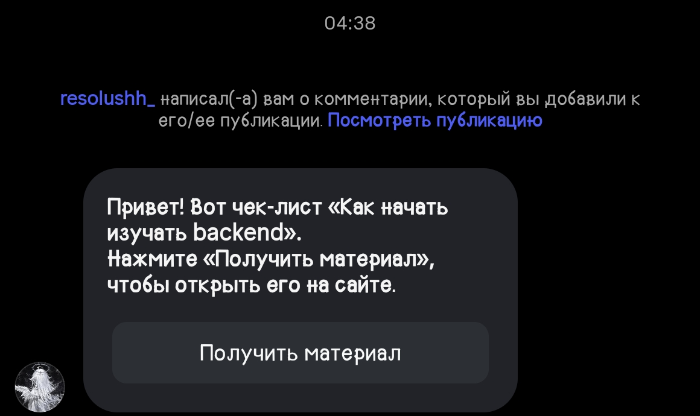

После нажатия кнопки сначала открылась страница переадресации ManyChat, затем материал на моём сайте.

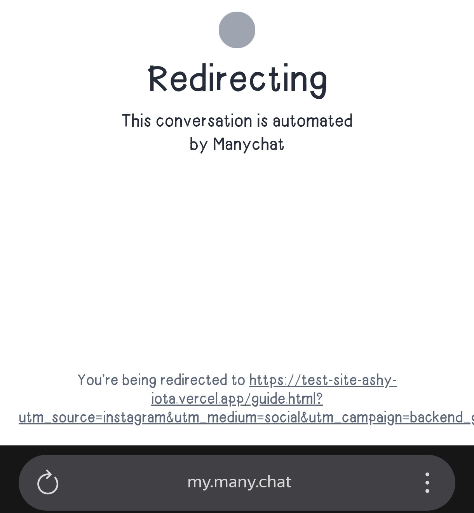

Ссылка в кнопке: [Получить материал](https://test-site-ashy-iota.vercel.app/guide.html?utm_source=instagram&utm_medium=social&utm_campaign=backend_guide&utm_content=reel01).

На телефоне все четыре UTM-метки сохранились, в том числе при переходе к форме. Адрес снял отдельно, чтобы метки было видно.

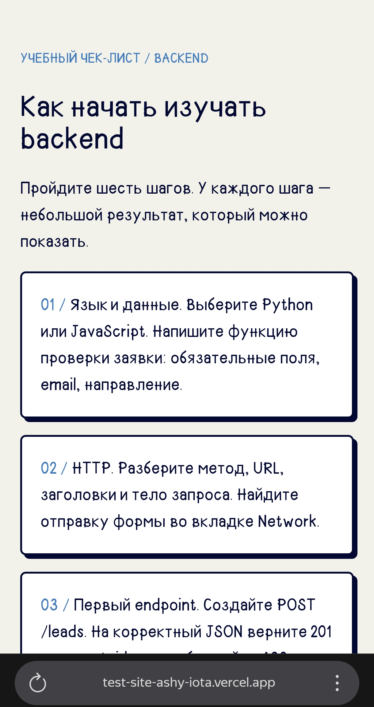

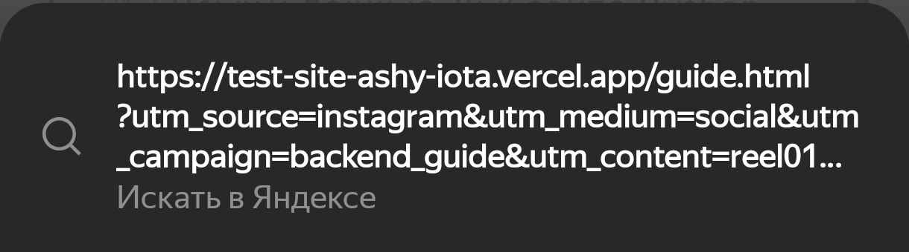

## 3. Результат

В GA4 появился просмотр `guide.html` и событие отправки заявки `generate_lead`. На скриншоте — 1 активный пользователь, 4 события `page_view` и 1 событие `generate_lead`.
В листе `leads` появилась строка с метками `instagram` / `social` /
`backend_guide` и статусом `new`.

`request_id` заявки: `REQ-5FEBABCC-4EA3-487B-96EA-316BC504A5B5`.

В [таблице заявок](https://docs.google.com/spreadsheets/d/1RheZQU1SYF2_5tNeVztqu4HX2Vjoi4QgZ9dg3o54Dh0/edit#gid=0) это строка 9: 27.10.2026, 05:12:04; имя Tester, направление `backend`.

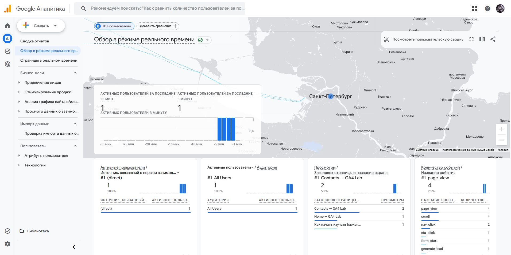

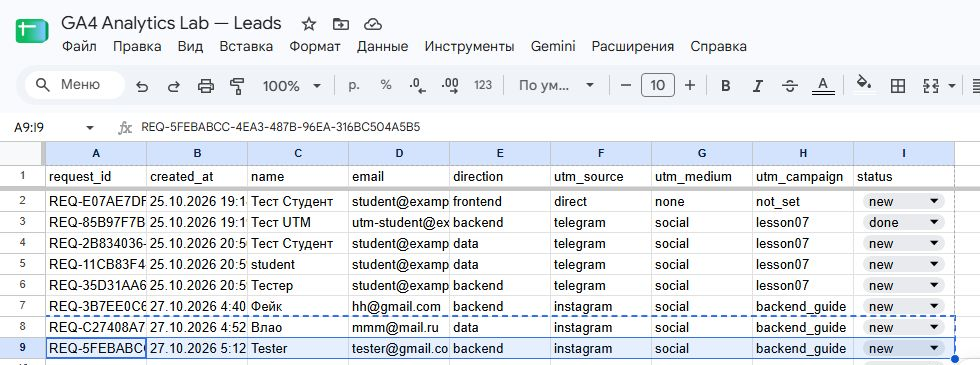

Дополнительно собрал отдельный [черновик с выбором направления](https://app.manychat.com/fb5843515/cms/files/content20261027021627_190353/edit). Кнопки Backend, Frontend и Analytics ведут к своим сообщениям и ссылкам с кампаниями `backend_guide`, `frontend_guide` и `analytics_guide`. Проверил все три сообщения в Preview. Как в презентации, оставил сценарий в Draft. Во всех ветках пока открывается одна страница `guide.html`.

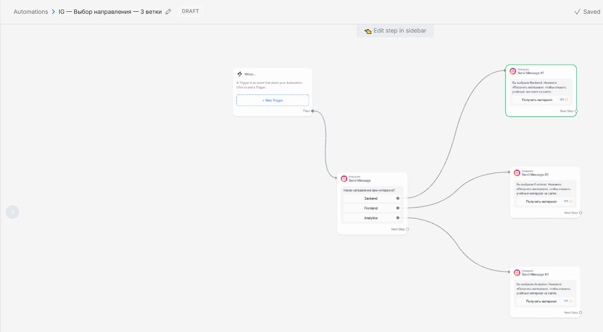

---

Сначала события не доходили до GA4 из-за проблем с доступом. Когда доступ заработал, в отчёте появились просмотр гайда и отправка заявки.

ИИ: использовал для проверки и оформления отчёта.
